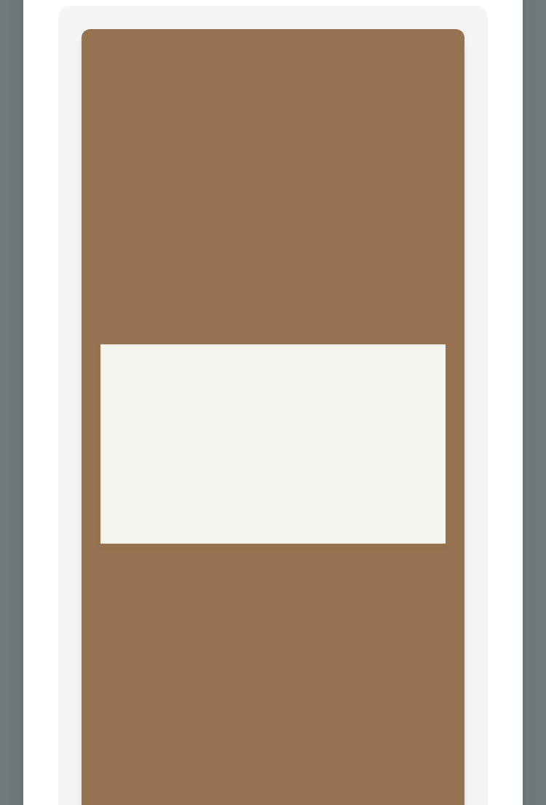
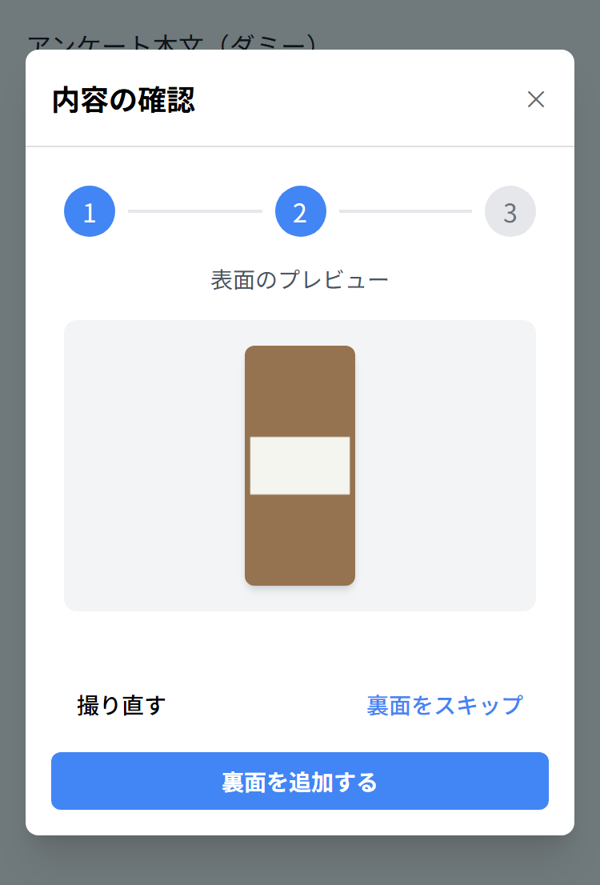
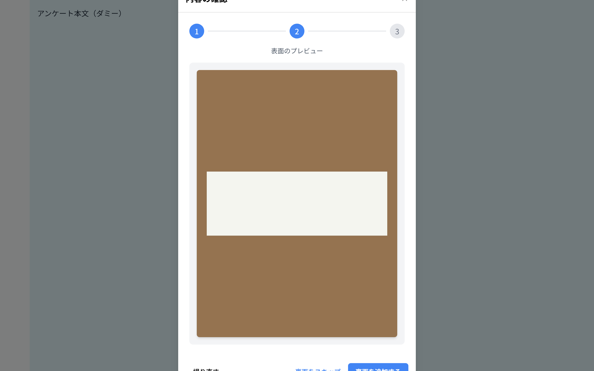
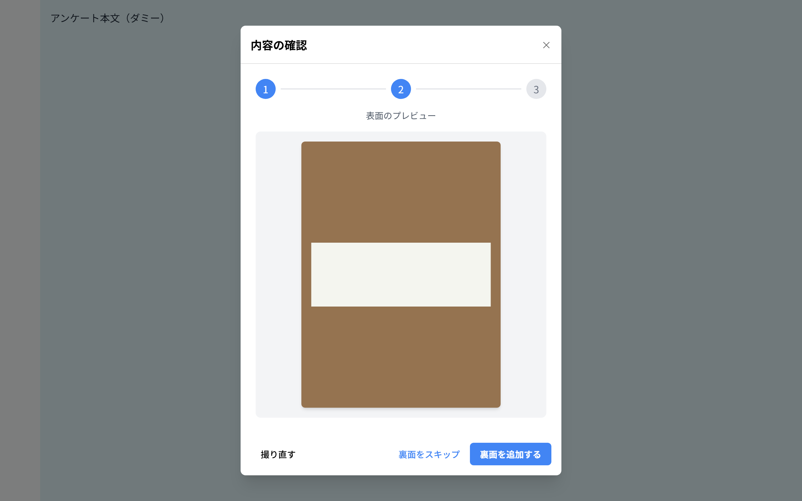
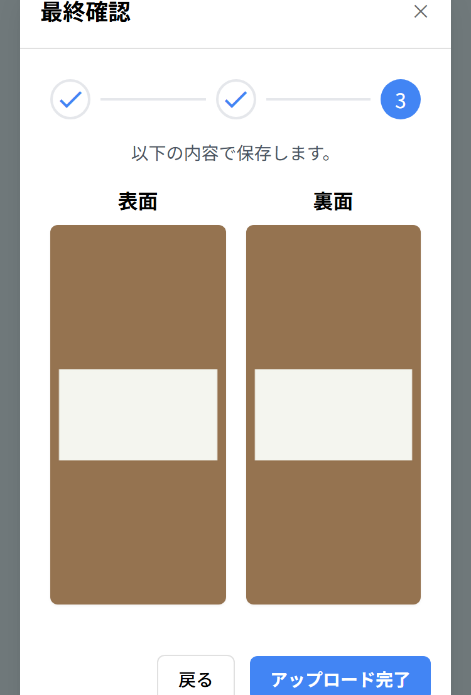
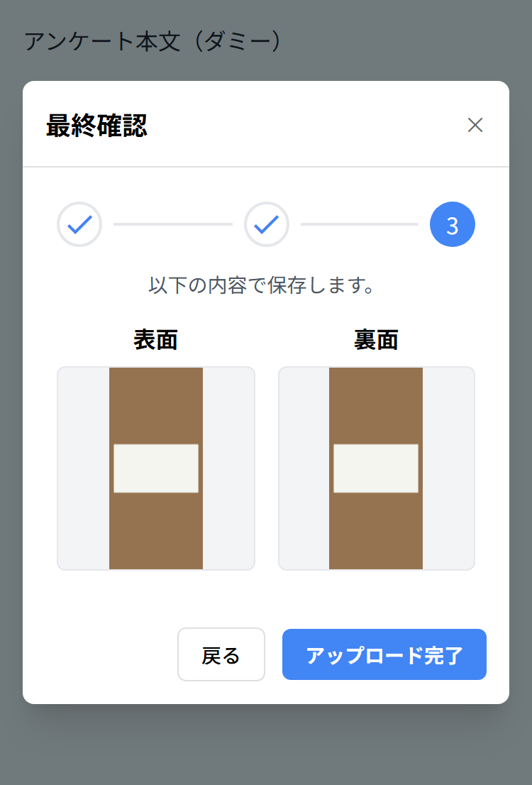

# SPDAD2026-207 名刺アップロードモーダル：縦長画像でボタンが画面外に出る／文言が折り返す 修正差分

- 課題: [SPDAD2026-207](https://repinc.backlog.com/view/SPDAD2026-207)
- 対象画面: アンケート回答画面 `/questionnaire_answer?id=...` の名刺アップロードモーダル
- 作成日: 2026-10-29
- 調べた本番資産: `https://speed-ad.com/build/assets/app-063bed3d.js`・`modalScrollManager-e140d68e.js`（2026-10-29 に GET で取得）

## 1. 何が起きているか

縦長の画像（カメラアプリの縦撮り、スマートフォンのスクリーンショットなど）を名刺として選ぶと、ステップ2「表面のプレビュー」の画像が縦横比のまま幅いっぱいに伸びます。モーダルには高さの上限もスクロールできる領域も無いので、下のボタン「撮り直す」「裏面をスキップ」「裏面を追加する」が画面外に押し出され、押せなくなります。PC（1280x800）でも 3:4 以上の縦長画像で起きます。

原因は次の 3 つが重なったことです。

| # | 箇所 | 現状 | 結果 |
|---|---|---|---|
| 1 | プレビュー画像 | `max-w-full` のみ。高さの上限なし | 縦長画像がそのまま縦に伸びる |
| 2 | モーダル本体 | `max-w-lg w-full m-4` のみ。高さの上限なし | モーダルが画面より高くなる。外枠は `items-center` なので上下が均等に切れる（タイトルも見えなくなる） |
| 3 | スクロール | モーダル内に `overflow-y: auto` の要素が無い | `modalScrollManager` が body を `position: fixed` で固定し、タッチ操作はモーダル内のスクロール可能な要素にしか渡さない。該当する要素が無いので、スワイプしても動かない |

もう 1 つ、画面幅 375px では 3 ボタンを 1 行に並べる幅が足りず、文言が「撮り直|す」「裏面をスキッ|プ」「裏面を追加す|る」のように文字単位で 2 行に割れます。

同じ作りの最終確認モーダル（ステップ3）も、画像が `w-full` だけで高さの上限がありません。表裏ともスクリーンショット比の画像だと、375x553 で「アップロード完了」の下端が画面外に出ます。

## 2. 修正内容

モックアップ（`02_dashboard/src/survey-answer.js`）で同じ症状を直したときの class をそのまま移します。本番も Tailwind Play CDN（JIT）を読み込んでいるので、任意値クラス（`max-h-[calc(100dvh-2rem)]` など）は追加の設定なしで効きます。

以下のテンプレートは、ビルド済みの `app-063bed3d.js` から起こしたものです。ソースのファイル名と行番号はわからないので、コンポーネント名 `BizcardImagePreviewModal` と `BizcardFinalConfirmModal` で探してください。`-` が現行、`+` が修正後です。変更は class だけで、イベントや表示条件は変えていません。

### 2.1 BizcardImagePreviewModal（ステップ2 表面／裏面のプレビュー）

```diff
 <div id="bizcard-upload-modal" data-managed-modal-scroll
      class="fixed inset-0 bg-black bg-opacity-50 hidden items-center justify-center z-50"
      :style="{ display: show ? 'flex' : 'none' }">
-  <div class="bg-surface rounded-lg shadow-xl max-w-lg w-full m-4">
+  <div class="bg-surface rounded-lg shadow-xl max-w-lg w-full m-4 max-h-[calc(100dvh-2rem)] flex flex-col">
-    <div class="flex justify-between items-center p-4 border-b border-outline-variant">
+    <div class="flex justify-between items-center p-4 border-b border-outline-variant shrink-0">
       <h3 class="text-lg font-bold">{{ labels.previewTitle }}</h3>
       <button type="button" class="close-modal-button ..." :aria-label="labels.close" @click="$emit('close')"> × </button>
     </div>
-    <div class="p-6">
+    <div class="p-6 overflow-y-auto grow">
       <!-- ステップインジケーター（変更なし） -->
       <p class="text-center text-sm text-gray-600 mb-4">{{ previewLabelText }}</p>
       <div class="bg-gray-100 p-4 rounded-lg">
-        
+        
       </div>
     </div>

     <!-- 裏面プレビューのフッター -->
-    <div v-if="isBackPreview" class="flex justify-end items-center p-4 bg-surface-container rounded-b-lg gap-3">
+    <div v-if="isBackPreview" class="flex justify-end items-center p-4 bg-surface-container rounded-b-lg gap-3 shrink-0">
       <button id="modal-cancel-button" ...>{{ labels.previewRetake }}</button>
       <button id="modal-save-button" ...>{{ labels.proceedFinal }}</button>
     </div>

     <!-- 表面プレビューのフッター -->
-    <div v-else class="flex items-center p-4 bg-surface-container rounded-b-lg gap-3 justify-between w-full">
+    <div v-else class="grid grid-cols-2 sm:flex sm:justify-between items-center p-4 bg-surface-container rounded-b-lg gap-3 w-full shrink-0">
-      <button class="px-4 py-2 text-sm font-medium rounded-md hover:bg-surface-container-high" @click="$emit('retake')">
+      <button class="justify-self-start whitespace-nowrap px-4 py-2 text-sm font-medium rounded-md hover:bg-surface-container-high" @click="$emit('retake')">
         {{ labels.previewRetake }}
       </button>
-      <div class="flex items-center gap-4">
+      <div class="contents sm:flex sm:items-center sm:gap-4">
-        <button class="text-sm font-medium text-primary hover:underline" @click="$emit('skip-back')">
+        <button class="justify-self-end whitespace-nowrap px-4 py-2 sm:px-0 text-sm font-medium text-primary hover:underline" @click="$emit('skip-back')">
           {{ labels.skipBackShort }}
         </button>
-        <button class="px-4 py-2 text-sm font-bold text-on-primary bg-primary rounded-md hover:bg-primary-dark" @click="$emit('add-back')">
+        <button class="col-span-2 whitespace-nowrap px-4 py-2 text-sm font-bold text-on-primary bg-primary rounded-md hover:bg-primary-dark" @click="$emit('add-back')">
           {{ labels.addBackAction }}
         </button>
       </div>
     </div>
   </div>
 </div>
```

各変更のねらいは次のとおりです。

- **モーダルの高さを画面内に収める**: 本体を `max-h-[calc(100dvh-2rem)] flex flex-col` にし、ヘッダーとフッターを `shrink-0` で固定、本文を `overflow-y-auto grow` にします。画面より高い中身は本文の中でスクロールし、ボタンは常に下端に見えます。本文が `overflow-y: auto` になるので、`modalScrollManager` もこの本文をスクロール先として見つけられます。`100dvh` は iOS Safari のアドレスバーとツールバーを除いた高さです。`100vh` だとバーの裏まで含むので使いません。
- **画像の高さに上限を付ける**: 640px 未満は `100dvh - 405px`（下限 150px）、640px 以上は `100dvh - 375px`（下限 200px）です。640px 未満で引く値が大きいのは、スマートフォン幅でフッターが 2 段になるためです。`object-contain` で縦横比は保ちます。表面と裏面で同じ class を使います。
- **ボタンの文言を割らない**: 640px 未満では、フッターを 2 列のグリッドにします。1 段目の左に「撮り直す」、右に「裏面をスキップ」、2 段目に全幅の「裏面を追加する」が並びます。右側の入れ物を `contents` にして、3 ボタンを直接グリッドに並べています。DOM の順（撮り直す → スキップ → 追加）は変わらないので、Tab の順と読み上げの順は見た目の順と一致します。640px 以上は現行と同じ 1 行です。各ボタンには `whitespace-nowrap` を付けます。「裏面をスキップ」には `px-4 py-2` を足し、スマートフォンでのタップ範囲を高さ 20px から 36px に広げています（640px 以上は横の余白だけ外すので、見た目は現行と同じです）。

### 2.2 BizcardFinalConfirmModal（ステップ3 最終確認）

```diff
-  <div class="bg-surface rounded-lg shadow-xl max-w-lg w-full m-4">
+  <div class="bg-surface rounded-lg shadow-xl max-w-lg w-full m-4 max-h-[calc(100dvh-2rem)] flex flex-col">
-    <div class="flex justify-between items-center p-4 border-b border-outline-variant">
+    <div class="flex justify-between items-center p-4 border-b border-outline-variant shrink-0">
       ...
-    <div class="p-6">
+    <div class="p-6 overflow-y-auto grow">
       ...
       <div class="grid grid-cols-2 gap-4">
-        <div>
+        <div class="flex flex-col">
           <p class="font-bold text-center mb-2">{{ labels.front }}</p>
-          
+          <div class="w-full h-36 sm:h-48 bg-gray-100 rounded-md border border-gray-200 flex items-center justify-center overflow-hidden">
+            
+          </div>
         </div>
-        <div>
+        <div class="flex flex-col">
           <p class="font-bold text-center mb-2">{{ labels.back }}</p>
-          
+          <div v-if="hasBackImage" class="w-full h-36 sm:h-48 bg-gray-100 rounded-md border border-gray-200 flex items-center justify-center overflow-hidden">
+            
+          </div>
-          <div v-else class="h-full flex items-center justify-center bg-gray-100 rounded-md">...</div>
+          <div v-else class="w-full h-36 sm:h-48 bg-gray-100 rounded-md border border-dashed border-gray-300 flex items-center justify-center overflow-hidden">...</div>
         </div>
       </div>
     </div>
     <!-- 拡大表示（変更なし） -->
-    <div class="flex justify-end items-center p-4 bg-surface-container rounded-b-lg gap-3">
+    <div class="flex justify-end items-center p-4 bg-surface-container rounded-b-lg gap-3 shrink-0">
```

サムネイルを高さ固定の枠（スマートフォン 144px／640px 以上 192px）に入れ、画像は枠の中で `object-contain` で縮めます。タップで拡大する動きは変えていません。

## 3. 確認結果

本番と同じ読み込み（Tailwind Play CDN・`app-51f661e3.css`・`service-top-style.css`）と本番の `modalScrollManager` で、上のマークアップの現行版と修正版を組んだページを Playwright（Chromium）で開き、ボタンの位置を測りました。現行版でボタンが画面外に出たケースでは、CDP のタッチ入力で上方向にスワイプして、ボタンに届くかも確かめています。画像は 3:4（1512x2016）、9:16（1080x1920）、スクリーンショット比（1170x2532）の 3 種です。

| 画面サイズ | モーダル | 現行 | 修正後 |
|---|---|---|---|
| 375x553（iPhone SE2 の Safari 表示域） | プレビュー | 3 種ともボタンが画面外。スワイプでも届かない。文言は 2 行 | 3 種とも画面内・1 行 |
| 375x667 | プレビュー | 9:16・スクリーンショット比で画面外。3:4 は画面内だが文言は 2 行 | 3 種とも画面内・1 行 |
| 360x640 | プレビュー | 9:16・スクリーンショット比で画面外。文言は 2 行 | 3 種とも画面内・1 行 |
| 1280x800 | プレビュー | 3 種ともボタンが画面外 | 3 種とも画面内・1 行 |
| 375x553 | 最終確認（表裏ともスクリーンショット比） | ボタン下端が 6px 画面外。スワイプでも届かない | 画面内 |
| 375x667・360x640・1280x800 | 最終確認 | 画面内 | 画面内 |

修正後は、上の全サイズと 639x700・640x700・1280x720 で、本文の内側に隠れる部分が 0px でした（画像が縮んで全体が収まる）。ページエラーは 0 件です。

| 375x553 現行 | 375x553 修正後 |
| --- | --- |
|  |  |

| 1280x800 現行（3:4 画像） | 1280x800 修正後 |
| --- | --- |
|  |  |

| 375x553 最終確認 現行 | 375x553 最終確認 修正後 |
| --- | --- |
|  |  |

実機（iPhone SE2 の Safari／Chrome）では確認していません。修正後は次の 3 点を実機で見てください。

1. 縦長の写真またはスクリーンショットを選び、ステップ2の 3 ボタンが画面内に見えて、文言が 1 行で押せること
2. 端末を横向きにしても、ボタンが画面内にあること（本文がスクロールすること）
3. 表裏とも縦長画像で、最終確認の「アップロード完了」が押せること

## 4. 補足

- `dvh` 単位は iOS Safari 15.4 以降、Chrome 108 以降で使えます。対応していないブラウザでは `max-h-[...]` の宣言そのものが無視され、現行と同じ表示になります（悪化はしません）。
- ステップ1（撮影方法の選択 `BizcardUploadModal`）とカメラ撮影モーダルは、今回の計測範囲には入れていません。
- モックアップの該当箇所: `02_dashboard/src/survey-answer.js` の `showModal()`（モーダル本体・本文・フッターの class）、`showFrontPreview()`・`showBackPreview()`（画像とフッター）、`showFinalConfirmation()`（固定枠 `BIZCARD_FRAME_CLASS`）。
